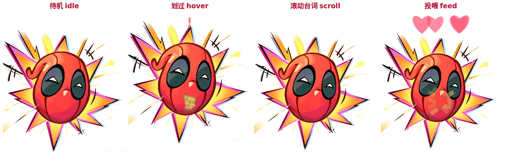

# 🦸 Deadpool 桌宠 / Deadpool Desktop Pet

一只住在你桌面角落的死侍：会呼吸、会贫嘴、会跟着鼠标炸一圈墨西哥卷饼。



*待机 idle · 划过 hover · 滚动台词 scroll · 投喂 feed*

## 特性

- 🖼 **图片形象**：直接用一张死侍图做形象，白底自动抠成透明、右下角水印已去除（`tools/prepare_image.py`）
- 🫁 **呼吸式缩放**：缓慢呼吸，最大面积 ≤ 最小面积 120%（±4.5%，周期 4 秒）
- 💬 **伪对话**：划过 / 单击 / 双击 / 拖拽都会说话；气泡内**文字自动滚动**，长台词也能完整显示
- 🌯 **墨西哥卷饼脉冲**：划过时炸一圈旋转小卷饼；右键「喂我 Chimichanga」冒爱心
- 💬 **聊天窗口**：右键「跟我聊聊」，打字对话（关键词回复，中英双语台词）
- 🖱 拖拽移动（记忆位置）、右键菜单（静音 / 锁定位置 / 退出）

## 为什么是 PySide6（Qt6）而不是 PyQt5

最初的版本是 PyQt5 写的，在开发机上不显示——**Qt5 / 旧式分层透明窗口在这台机器上不出来，但 Qt6 的 DirectComposition 透明窗口可以正常显示**。所以整个项目迁到了 PySide6，跑在 Windows 原生 Python 上，不依赖 WSLg。迁移脚本保留在 `tools/convert_to_pyside6.py`。

Qt 的几个坑也在代码里绕过了：彩色 emoji 在 DirectComposition 半透明窗口路径下画不出来，所以 🌯 是**离屏预渲染成 QImage 再 blit** 的（见 `pet_window._chimi_image`）。

## 环境要求

- Windows 10/11（其他平台理论可跑，未测试）
- Python 3.10+
- PySide6

## 安装与运行

```bat
git clone https://github.com/cutiedirt/DeadpoolPet.git
cd DeadpoolPet
pip install -r requirements.txt
python main.py
```

想要无黑窗启动，用 `pythonw.exe main.py`（或建一个指向它的快捷方式）。

> `Pillow` / `numpy` 只有重新抠图时才需要，跑桌宠本身用不到。

## 交互

| 操作 | 反应 |
|---|---|
| 鼠标划过 | 受惊跳一下 + 打招呼 + 卷饼脉冲 |
| 单击 | 被戳的吐槽 |
| 双击 | 招牌动作台词 + 卷饼爆发 |
| 拖拽 | 移动（松手记忆位置，下次启动还在那儿） |
| 右键 | 菜单：喂食 / 聊天 / 静音 / 锁定 / 退出 |

## 换图

1. 把新图片放到任意位置，改 `tools/prepare_image.py` 顶部的 `SRC` 常量
2. `python tools\prepare_image.py` → 重新生成 `assets\sprite.png` 和 `assets\icon.png`
3. 重启桌宠

抠图脚本会做三件事：按到白色的距离生成 alpha、把**内部空洞**（比如眼白）回填成不透明、以及去掉右下角水印。

## 测试与调试

```bat
python tests\interaction_test.py        :: 16 项交互回归测试
python main.py --shot=out.png           :: 启动 3.5 秒后自截图退出
```

无显示环境（CI / 远程）下跑测试：

```bat
set QT_QPA_PLATFORM=offscreen
python tests\interaction_test.py
```

## 项目结构

```
main.py                     入口，字体注册 / 图标 / --shot 调试钩子
deadpool_pet/
  pet_window.py             主窗口：状态机、呼吸缩放、滚动气泡、粒子、拖拽、右键菜单
  dialogue.py               台词库（中英对照）+ 关键词聊天大脑
  chat_window.py            「死侍热线」聊天窗
  sprite.py                 精灵渲染 + 呼吸曲线
tools/
  prepare_image.py          白底抠图 + 去水印 + 内部空洞回填
  convert_to_pyside6.py     PyQt5 → PySide6 迁移脚本
tests/
  interaction_test.py       16 项交互回归测试
assets/                     sprite.png / icon.png / 中文字体
showcase.png                四联展示图
```

## 已知限制

- 只测过 Windows；Linux/macOS 的透明窗口路径没验证过（代码里有 `X11BypassWindowManagerHint` 分支，属于未测试代码）。
- 聊天是关键词匹配，不是真 AI。

## 免责声明

粉丝自制桌宠，仅供个人娱乐与学习，与漫威 / Marvel 无任何关联。死侍形象版权归 Marvel 所有。
